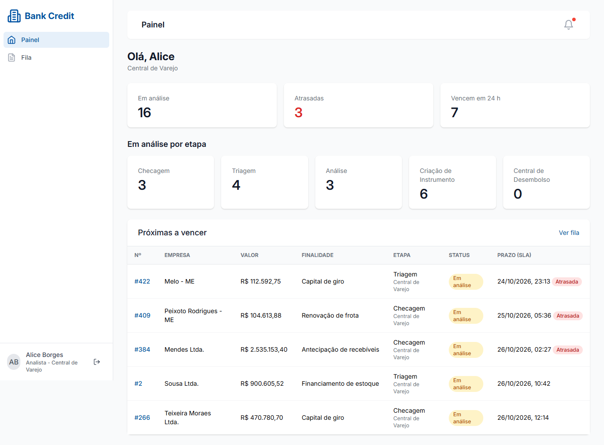
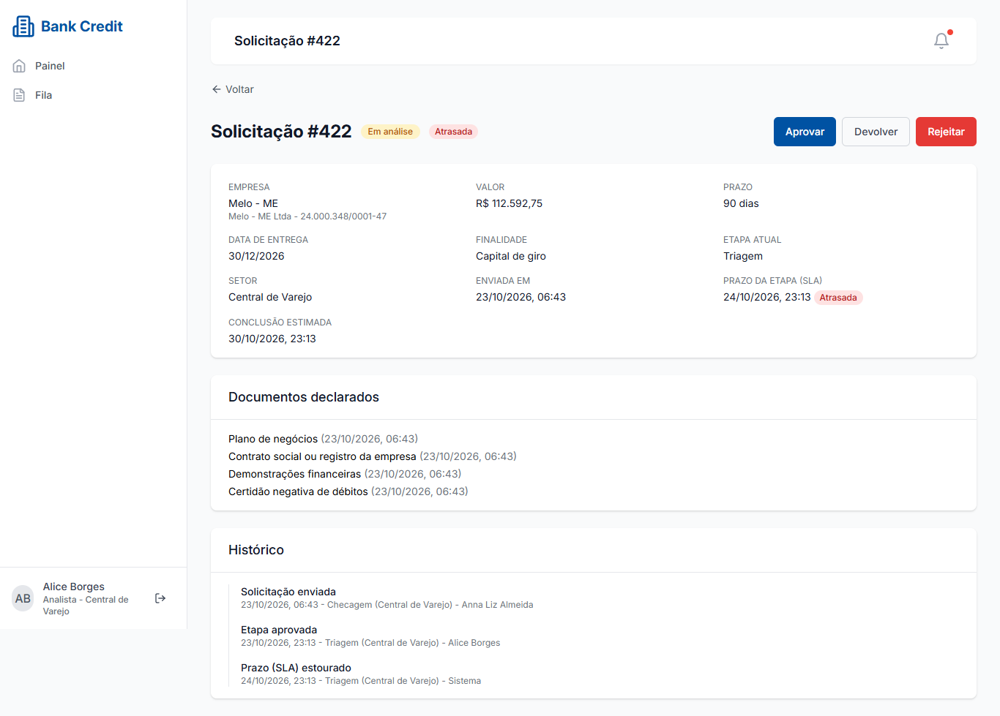
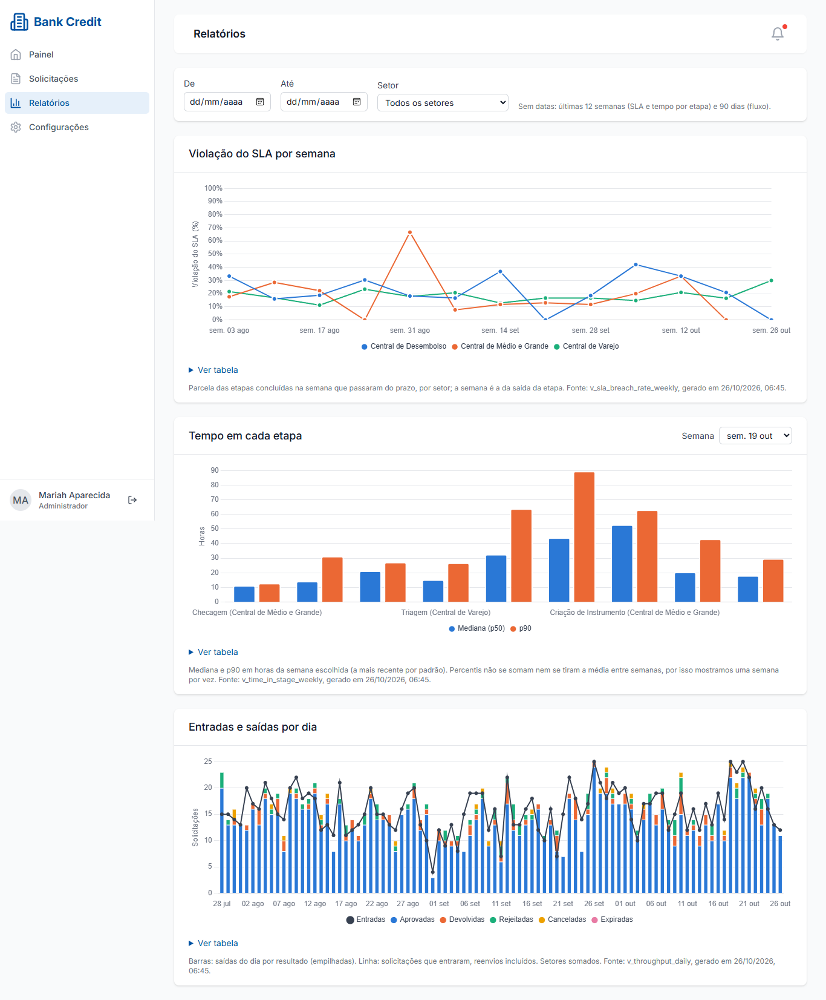

# Bank Credit

> A credit-request workflow (FastAPI, Postgres, React) whose every state change lands in an
> append-only event log, turned into SLA analytics with SQL views and checked dataset exports.


Companies ask for credit; the request moves through five review stages (Checagem, Triagem,
Análise, Criação de Instrumento, Central de Desembolso), each owned by a sector chosen by amount
band and bound by an SLA. Staff approve, return or reject; customers resubmit or cancel. The data
side answers how long requests sit in each stage, how often SLAs are missed and what each sector
gets through per day.

## What this demonstrates

- **Event log as the source of truth.** One transition service writes every change to
  `request_events` (append-only, enforced by a Postgres trigger and an ORM guard) and updates the
  current-state projection in the same transaction; tests replay the log and compare.
- **SLA analytics in SQL.** Versioned views build stage intervals with window functions
  (`LEAD`), then weekly breach rates, p50/p90 time in stage (`percentile_cont`) and daily
  throughput per sector. Alembic applies them; the files are never edited once released.
- **Idempotent jobs with run metadata.** `seed`, a deterministic `simulate` (same seed and
  as-of, same events), `sla-check` (events stamped at the deadline, so reruns write nothing) and
  `export` all record a `job_runs` row with run_id, UTC times and row counts.
- **Data contracts at the boundary.** Exports validate every row against pydantic contracts, run
  batch checks (unique and contiguous sequences, monotonic time, nulls), and publish a partition
  with a manifest and sha256 only when everything passes.
- **Typed end to end, reproducible in one command.** SQLAlchemy 2 typed models, mypy strict,
  OpenAPI to generated TypeScript types with drift checks in CI, `make up` for the whole stack,
  and CI that runs Postgres integration tests and an end-to-end smoke through the web proxy.

## Architecture


Source: [architecture.d2](docs/diagrams/architecture.d2).

### Data flow


Source: [data-flow.d2](docs/diagrams/data-flow.d2).

| Layer | Objects | Guarantees |
| --- | --- | --- |
| Source | API transitions, `simulate`, `sla-check` | One write path (`workflow.transition`), role and sector checks, `expected_seq` for concurrency |
| Raw | `request_events`, `credit_requests`, `request_documents`, `job_runs` | Append-only log; projection replayable from the log; UTC `timestamptz`; `numeric(14,2)` money |
| Processed | `v_request_stage_intervals` | One row per stage entry; a pure function of the log |
| Serving | `v_sla_breach_rate_weekly`, `v_time_in_stage_weekly`, `v_throughput_daily`, `/analytics/*`, export partitions | Contracts and batch checks before publishing; manifest with row count and sha256 |

More detail: [docs/architecture.md](docs/architecture.md) (user flows per role and the data
model), [docs/data-contracts.md](docs/data-contracts.md), [docs/runbook.md](docs/runbook.md).

## Tech stack

Python 3.12 · FastAPI · SQLAlchemy 2 · Alembic · Postgres 17 · pydantic · uv · ruff · mypy ·
pytest · TypeScript · React · Vite · react-query · Chart.js · nginx · Docker Compose ·
GitHub Actions

## Quickstart

```bash
git clone https://github.com/emanuel-luis/bank-credit && cd bank-credit
make up      # creates .env with generated secrets, builds and starts the stack
```

Without make: `cp .env.example .env`, set `SECRET_KEY` and `POSTGRES_PASSWORD`, then
`docker compose up -d --build --wait`.

Compose runs the migrations, seeds the workflow and demo users, simulates 120 days of history and
starts the API and the web app:

- Web: http://localhost:8080
- API docs: http://localhost:8000/docs

Demo logins (password `DEMO_PASSWORD` from `.env`, `demo1234` by default; local use only):
`customer1@example.com`, `staff1.retail_center@example.com`,
`manager.retail_center@example.com`, `admin@example.com`.

`make down` stops everything and deletes the database volume; the next `make up` builds fresh
demo data. Demo requests are dated relative to the day they were simulated, so refresh them this
way after a few weeks.

## Jobs

| Command | What it does | Re-run behavior |
| --- | --- | --- |
| `bank-credit seed` | Stages, sectors, amount-band routes, demo users | Get-or-create by code and email |
| `bank-credit simulate --seed 42` | Synthetic history through the real transition service | Skips when the same parameters already succeeded; `--reset` rebuilds |
| `bank-credit sla-check` | Writes SLA_BREACHED and EXPIRED events that came due | Events carry the deadline as time, so a rerun writes nothing |
| `bank-credit export --dataset ...` | Checked CSV or Parquet partition plus `_manifest.json` | Same as-of and data give identical bytes; failures publish nothing |

Each run writes a `job_runs` row (run_id, status, UTC start and end, rows read and written), and
events written by a job carry its `job_run_id`.

```bash
make export DATASET=sla_breach_weekly   # writes data/exports/sla_breach_weekly/as_of=<date>/
make sla-check
```

## Screenshots

| Staff queue | Request detail and history | SLA reports |
| --- | --- | --- |
|  |  |  |

## Development

```bash
make install           # uv sync + npm ci
make lint              # ruff, ruff format --check, mypy, eslint, tsc (same as CI)
make test              # backend unit tests (SQLite)
make test-integration  # Postgres integration tests against the compose database
make smoke             # end-to-end API smoke through nginx (stack must be up)
make d2-install        # once: the pinned D2 v0.9.0 (Linux x86_64), checksum verified
make diagrams          # render docs/diagrams/*.d2 to the committed SVGs
make diagrams-check    # render, then fail if a committed SVG is stale (same as CI)
make diagrams-watch NAME=architecture   # live preview in the browser while editing
```

Diagrams are D2 sources in `docs/diagrams/`; edit the `.d2`, run `make diagrams` and commit both
files. On Windows, run these targets in WSL.

CI runs lint, unit tests, Postgres integration tests (service container), the frontend checks
(lint, typecheck, vitest, build, generated-types drift), a D2 render check of the diagrams and a
compose smoke that brings the stack up and drives a request through all five stages. `security.yml` runs pip-audit and npm audit;
Dependabot proposes weekly updates.

## Project structure

```
backend/
  src/bank_credit/
    app/
      domain/      # enums, CPF/CNPJ checks, reference workflow, transition service
      routers/     # auth, credit requests, notifications, analytics
      jobs/        # runs (job_runs), seed, simulate, sla_check, export
      contracts/   # pydantic contracts of exported rows
      models.py db.py schemas.py cli.py main.py
    sql/views/     # versioned analytics views (*.v1.sql)
  alembic/         # 0001 schema, 0002 append-only trigger, 0003 documents, 0004 views
  tests/           # unit (SQLite) and integration (Postgres)
frontend/          # React + Vite SPA, generated API types, nginx config
scripts/smoke.py   # end-to-end smoke used by CI
docs/              # architecture, data contracts, runbook, decisions
  diagrams/        # D2 sources (*.d2) and the rendered SVGs
compose.yaml  Makefile
```

## License

MIT, see [LICENSE](LICENSE).
