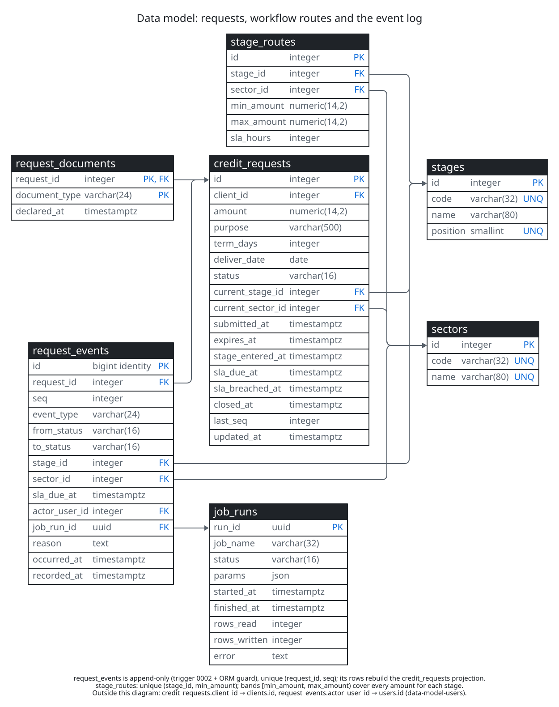
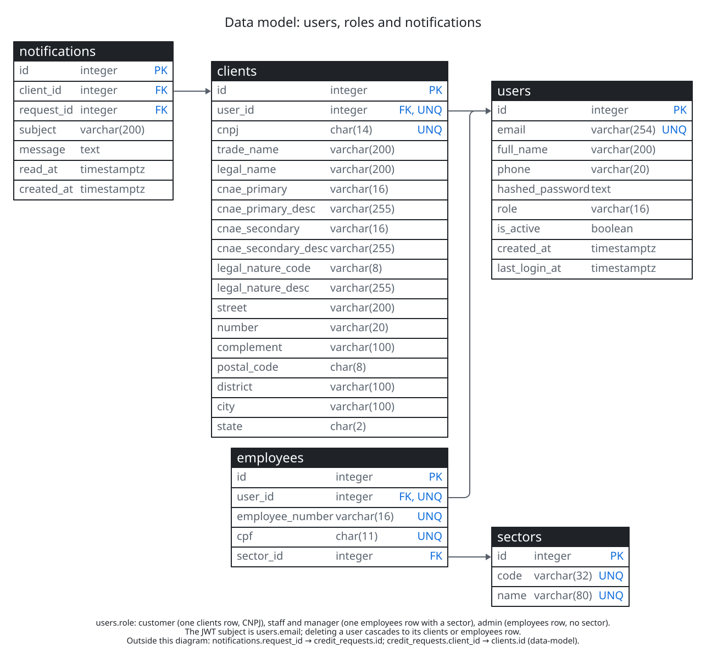

# Architecture

Diagrams are D2 sources in [diagrams/](diagrams/), rendered to the SVGs shown here by
`make diagrams` and checked in CI. The layer view from the log to analytics and exports is the
[data flow](diagrams/data-flow.svg) ([source](diagrams/data-flow.d2)).

## Components

Source: [architecture.d2](diagrams/architecture.d2).

Compose starts `postgres`, then the one-shot `migrate` and `seed` containers, then `api` (once
seeding succeeded) and `web` (once the API is healthy). The SPA calls `/api`, which nginx forwards
to the API, so browser and API share an origin and CORS stays closed. API and web listen on
127.0.0.1 only because the demo users have a published password.

## Write path

Every change to a request goes through `app/domain/workflow.py`:

1. Lock the request row (`SELECT ... FOR UPDATE`).
2. Validate before writing anything: the actor must be a party to the action (customer owner,
   staff or manager of the current sector, admin), `expected_seq` must equal `last_seq`, the
   action must be allowed from the current status, and returns and rejections need a reason. A
   rejected call writes nothing.
3. Apply due system events (SLA_BREACHED, then EXPIRED, stamped at their deadlines). If the
   request expired, the action is refused with 409 `request_expired`; the EXPIRED event is kept.
4. Insert the event with `seq = last_seq + 1` and update the projection columns on
   `credit_requests` (status, stage, sector, `sla_due_at`, `closed_at`) in the same transaction.
   `expires_at` is set once, at submission.

`unique(request_id, seq)` turns any race the lock misses into a conflict. The projection is a
cache of the log: `workflow.replay(events)` rebuilds it, and the tests compare both for every
request.

`request_events` is append-only. A Postgres trigger rejects UPDATE and DELETE (revision 0002), and
an ORM `before_flush` guard does the same in SQLite unit tests. TRUNCATE stays allowed so the
simulation can reset.

### Workflow

| Stage | Position | Sectors by amount band | SLA |
| --- | --- | --- | --- |
| Checagem | 1 | Central de Varejo below R$ 4,800,000.00; Central de Médio e Grande from it | 24 h / 48 h |
| Triagem | 2 | same bands | 24 h / 48 h |
| Análise | 3 | same bands | 72 h / 120 h |
| Criação de Instrumento | 4 | same bands | 48 h / 72 h |
| Central de Desembolso | 5 | Central de Desembolso for any amount | 24 h |

Statuses: IN_REVIEW, RETURNED (waiting for the customer), and the terminal APPROVED, REJECTED,
CANCELLED, EXPIRED (45 days after submission). Events: SUBMITTED, STAGE_APPROVED, RETURNED,
RESUBMITTED, REJECTED, CANCELLED, EXPIRED, SLA_BREACHED.

### Customer: submit and resubmit

Source: [user-flows-customer.d2](diagrams/user-flows-customer.d2).

### Staff: move a request through the stages

Source: [user-flows-staff.d2](diagrams/user-flows-staff.d2).

## Read path

The analytics views are plain SQL views over `request_events` (decision 53):

- `v_request_stage_intervals`: one row per entry into a review stage, with exit time, exit event,
  duration and whether the SLA was missed. SLA_BREACHED events are not interval boundaries.
- `v_sla_breach_rate_weekly`: closed intervals, breached intervals and the breach rate per sector
  and exit week (UTC Monday).
- `v_time_in_stage_weekly`: n, average, p50 and p90 hours per stage, sector and exit week.
  Percentiles are per bucket and cannot be averaged across weeks.
- `v_throughput_daily`: per sector and day, intervals entered and how they ended.

The SQL lives in `backend/src/bank_credit/sql/views/<name>.v1.sql`; revision 0004 applies it. A
change ships as new `v2` files and a new revision, so released migrations never change.

`/analytics/*` serves the views to managers (own sector only) and admins, and the Reports page
charts them.

Source: [user-flows-reports.d2](diagrams/user-flows-reports.d2).

## Jobs and run metadata

`job_run(db, name, params)` wraps every job: it inserts a `job_runs` row (`running`), sets
`succeeded` or `failed` with the error, and records UTC start and end plus rows read and written.
Events written by a job carry its `job_run_id`, so any row in the log can be traced to the API
call or the run that produced it.

Source: [user-flows-sla-check.d2](diagrams/user-flows-sla-check.d2). Nothing in the repository
schedules the job; the [runbook](runbook.md) suggests every 15 minutes.

## Data model

Every arrow is a declared foreign key; the tables come from Alembic revisions 0001 to 0003.

Source: [data-model.d2](diagrams/data-model.d2).

Source: [data-model-users.d2](diagrams/data-model-users.d2).
